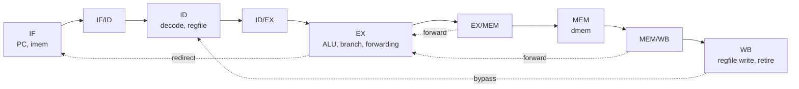

# Architecture

5-stage in-order RV32I pipeline. Source: `rtl/`.

| Module | Role |
|---|---|
| `rv32_core` | Pipeline registers, hazard/forwarding logic, branch resolution, load/store formatting |
| `rv32_decoder` | Combinational decode: immediates, ALU op, operand selects, control, `uses_rs1/rs2` |
| `rv32_alu` | ADD SUB SLL SLT SLTU XOR SRL SRA OR AND |
| `rv32_regfile` | 2R1W, x0 = 0, same-cycle write-to-read bypass |
| `rv32_imem` / `rv32_dmem` | 4 KiB Harvard memories (comb. read; data write is synchronous with byte enables) |
| `rv32_system` | Core + memories, exposes the retire/debug ports to the testbench |

## Hazards

| Hazard | Handling |
|---|---|
| RAW, producer 1 ahead | Forward EX/MEM result to EX (ALU, branch compare, store data, JALR base) |
| RAW, producer 2 ahead | Forward MEM/WB result to EX |
| RAW, producer 3 ahead | Register-file write-to-read bypass in ID |
| Same register written by two older instructions | EX/MEM has priority over MEM/WB (younger value wins) |
| Load followed by a consumer | One-cycle stall in ID (PC and IF/ID held, bubble into ID/EX); load data is then forwarded from MEM/WB |
| Taken branch, JAL, JALR | Resolved in EX; flush IF/ID and ID/EX; 2-cycle penalty; static not-taken prediction |
| x0 | Never written, never forwarded (`rd != 0` guards), reads as zero |

A stall needs a load in EX and a redirect needs a branch or jump in EX, so they can never coincide;
the testbench asserts this.

## Scope and simplifications

* RV32I base integer ISA only: no CSRs, no interrupts, no M/A/C extensions, no FENCE semantics.
* ECALL retires like a NOP and marks the end of a test program.
* Misaligned accesses and illegal opcodes are not modelled (illegal opcodes act as NOPs).
* Memories are behavioural arrays with combinational reads, not synchronous SRAM macros.
* No branch predictor, no caches.
